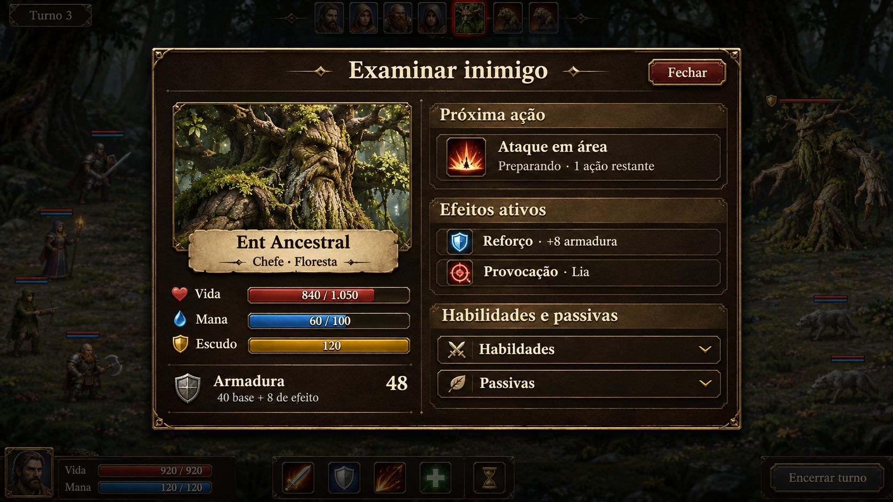

# Dungeon v4 — proposta baseada na campanha

## Escopo para aprovação

A campanha será a fonte das regiões, criaturas, chefes, classes, subclasses, habilidades, passivas, equipamentos, poções, atributos e fórmulas. A dungeon usa esse conteúdo numa jornada de um a três jogadores. O trabalho é substituir os caminhos antigos da dungeon por um único fluxo de combate que usa as mesmas regras da campanha e aplica ajustes explícitos de grupo.

Veja também a [referência das habilidades que mudam na dungeon](diferencas-de-habilidades.md).

A auditoria inicial parte do [sistema atual da dungeon](sistema_roguelite.md), da [referência de habilidades da dungeon](referencia_habilidades.md) e das [fórmulas dos heróis da campanha](../referencia_habilidades_atual.md). O catálogo e as regras ativos no código da campanha terão prioridade em caso de diferença com as referências.

## O que vem da campanha

| Sistema | Regra proposta |
|---|---|
| Inimigos e chefes | Mesmas fichas, nomes, raridades, níveis, ataques, custos, defesas, condições de uso e fases da campanha. Usar os mesmos sprites e animações. |
| Heróis | Mesmas quatro classes-base, mesmos ramos nos níveis 30 e 60 e mesmas habilidades, passivas e melhorias. Preservar o funcionamento do ataque básico de cada classe. |
| Resolução | Mesmas fórmulas de dano, crítico, esquiva, armadura, mana, cura e efeitos. A dungeon define quem recebe o efeito e aplica os fatores de grupo abaixo. |
| Equipamento e poções | Mesmos catálogos, restrições e efeitos. A dungeon continua com inventário e economia separados, incluindo a exclusão de O Fim já definida para esse modo. |

## Como a jornada funciona

- Um herói por jogador, com 40 moedas individuais, duas poções de vida e duas de mana e sem equipamento inicial. Solo começa ou retoma diretamente. Para retomar online, o anfitrião confirma o tamanho do grupo salvo, e cada participante entra na sala e escolhe um herói desse grupo. A aventura só abre quando todos estiverem presentes.
- A base mantém saguão, acampamento e ferreiro. Todos marcam prontidão antes da caçada. Equipar, descansar e trocar itens ou moedas continua no acampamento, com aceite para concluir a troca. O ferreiro compra e aprimora peças.
- A rota segue as 12 regiões da campanha. Em cada região, a ordem é combate com comuns e incomuns → apostador → combate com as três raridades → alquimista → combate com incomuns e raros → ferreiro viajante → caverna com três lutas e o chefe. Isso dá 84 batalhas. Após combates comuns, o grupo pode voltar à base. Na caverna, a pausa permite usar poções e evoluir antes da luta seguinte.
- Encontros têm um inimigo por jogador. Em coop, o chefe tem acompanhantes da região e conserva o ajuste já usado de +65% de vida máxima por jogador adicional. Ataque, defesa e habilidades continuam vindo da campanha. O equipamento do grupo não altera os atributos dos inimigos.
- Manter a curva de XP atual da dungeon, calibrada para chegar ao nível do chefe na sexta vitória de cada região. Heróis caídos retornam após vitória com 20% da vida máxima. Derrota de todo o grupo encerra a expedição.

## Alquimista, acampamento e perfis

- **Alquimista.** Cada visita terá cinco ofertas. A primeira é sempre uma poção de vida, com a qualidade calculada pelo nível médio dos heróis usando a mesma faixa do encontro. As outras quatro são sorteadas entre os demais tipos, sem repetir o tipo. O estoque continua compartilhado e o pagamento sai da carteira de quem compra.
- **Aba Habilidades no acampamento.** Mostrar habilidades ativas e passivas, custo, requisitos, melhorias desbloqueadas e efeitos. A descrição informa o alvo e os fatores de área efetivamente usados na dungeon. A aba serve para consulta e usa os nomes e ícones da campanha.
- **Distribuição de atributos.** Abrir uma tela extra como na campanha quando houver pontos pendentes após a evolução, em uma pausa segura entre lutas. Mostrar Força, Vitalidade e Sabedoria, saldo de pontos e prévia dos ganhos. Reaproveitar os controles de ajuste e confirmação da campanha. Cada jogador confirma os pontos do próprio personagem. A próxima luta só libera quando todos concluírem as escolhas pendentes.
- **Perfil de outro jogador.** Ao abrir o perfil pelo personagem, usar o mesmo painel de status do acampamento, em modo de consulta. Mostrar nível, classe, pontos investidos em Força, Vitalidade e Sabedoria, vida, mana e os demais atributos exibidos para o próprio herói. Ler os valores do personagem inspecionado a partir do estado sincronizado da partida.

## Alvos e balanceamento em grupo

Cada habilidade existente recebe uma configuração explícita de alvo. A configuração padrão replica a campanha. As exceções são listadas por habilidade, para revisão, antes da implementação. Os fatores abaixo são valores iniciais para teste.

| Aplicação | Alvo | Potência por alvo |
|---|---|---|
| Ataque ou debuff de alvo único | Um inimigo escolhido | 100% da campanha |
| Cura, buff ou escudo direcionado | Um aliado vivo escolhido, incluindo o próprio herói | 100% da campanha |
| Dano direto em área | Inimigos vivos | **70%** do dano direto por alvo, antes da mitigação |
| Dano periódico em área | Inimigos vivos | **70%** do valor por aplicação, com a duração da campanha |
| Cura em área | Aliados vivos | **60%** da cura por alvo, incluindo cura periódica |
| Buff ou escudo em área | Aliados vivos | **60%** da magnitude do bônus ou do valor do escudo |
| Debuff numérico em área | Inimigos vivos | **60%** da magnitude da penalidade |
| Efeito de área indivisível | Alvo principal escolhido | Controle binário, como perder um turno, ou proteção absoluta, como invulnerabilidade, é aplicado integralmente apenas ao alvo principal. Efeitos numéricos secundários continuam em área com o fator correspondente. |

Os fatores de área são aplicados quando há mais de um alvo vivo elegível no momento da resolução. Rajada de Flechas é uma exceção, com um disparo sem redução por inimigo vivo no modo de área. Com um único alvo vivo, usa-se a potência integral da campanha. Aliados com vida cheia ainda contam para esse cálculo. Aplicações que sempre são pessoais, como o custo em vida de uma habilidade ou o bônus exclusivo de uma transformação, continuam pessoais.

**Exemplos de cálculo.** Cura-base de 100 em três aliados vivos cura até 60 em cada um. Um buff-base de +20% de ataque em grupo vira +12% em cada aliado. Uma redução-base de 25% de ataque em área vira 15% por inimigo. O dano-base de 100 em três inimigos entra na mitigação de cada um com 70. Os fatores atuam no efeito correspondente uma vez, mesmo quando a habilidade combina vários efeitos.

**Custos e efeitos.** A habilidade gasta mana, carga e turno uma única vez. Crítico, esquiva, defesa e imunidade são resolvidos por alvo conforme as regras da campanha. Roubo de vida, regeneração do conjurador, passivas e efeitos de equipamento seguem o gatilho da campanha. Quando o gatilho é por uso, ele é resolvido uma vez para o ataque inteiro. Efeitos com duração mantêm a contagem da campanha.

### Habilidades existentes que exemplificam as adaptações

| Habilidade | Uso na dungeon |
|---|---|
| Recuperar Fôlego | Uso exclusivo no próprio Guerreiro e nas subclasses que herdam a habilidade. A cura e as melhorias associadas seguem a campanha e são aplicadas ao conjurador. O comando usa confirmação pessoal, sem seleção de aliado. |
| Escudo de Mana e Casulo de Vinhas | Protegem um aliado escolhido. A fórmula do escudo continua usando os atributos definidos pela habilidade na campanha. |
| Escudo de Fé e Bomba de Fumaça | Transferem a proteção ao aliado escolhido. Como o efeito é de alvo único, a proteção mantém sua eficácia. |
| Brado de Cavaleiro e Paladino | O fortalecimento alcança o grupo com o fator de buff em área. A provocação segue sua própria regra. |
| Concentração do Arquimago | Uso próprio. Os bônus de dano e regeneração de mana ficam no conjurador. |
| Rajada de Flechas | Escolher entre todos os disparos em um inimigo e um disparo de dano integral por inimigo vivo. |
| Bafo de Fogo e Descarregar | Cada inimigo recebe a resolução individual do dano em área e dos efeitos originais aplicáveis. |
| Nevasca | O efeito numérico de resfriamento pode atingir o grupo inimigo com o fator de debuff. A perda de ação, quando prevista pela habilidade e permitida pelas imunidades, fica no alvo principal. |
| Canção Ancestral | Cura o grupo vivo com o fator de cura em área. O escudo da variante do Protetor usa o fator de escudo e a redução de ataque da variante da Fada usa o fator de debuff. |

### Provocação e comportamento inimigo

A lista de habilidades que provocam mantém a prioridade já definida, da maior para a menor. Brado do Paladino, Brado do Cavaleiro, Forma Verdadeira do Avatar da Natureza, Encanto da Brisa do Protetor da Floresta, Armadilha do Guarda Florestal, Ira do Berserker e Congelar do Mago Frígido.

Cada inimigo provocado guarda três ações próprias de duração. Empates favorecem a aplicação mais recente. Um provocador caído perde a condição de alvo. Provocação redireciona ataques hostis de alvo único e preserva ataques em área, curas e buffs do inimigo. Esbarrão, Contundir e Você irá me parar seguem sem provocação.

A IA decide **qual ação** executar com as condições e prioridades da campanha, incluindo fases, cargas e limites de mana. A dungeon resolve **quem recebe** a ação em grupo. Sem provocação, respeita preferências explícitas da habilidade. Quando a campanha pressupõe um único herói e não há preferência, sorteia entre os vivos. Suporte inimigo usa os critérios da habilidade para escolher aliados. A interface mostra habilidade, alvo ou área e mudanças de alvo antes da execução.

### Habilidades dos inimigos no combate em grupo

O catálogo ativo de `campaign-enemy-combat.js` será a referência para as habilidades das 12 regiões. A tabela antiga de golpes genéricos da dungeon documenta o legado que será substituído. A matriz de implementação terá uma linha para cada habilidade e passiva inimiga, com gatilho, custo, duração, alvo na campanha, alvo na dungeon e regra de resolução.

| Habilidade ou efeito da campanha | Resolução na dungeon |
|---|---|
| Básico e especial de alvo único | Atingem um herói vivo. Provocação tem prioridade quando aplicável. Preservam custo, fórmula, esquiva e efeitos secundários. Dano baseado na vida máxima usa a vida máxima do alvo escolhido. |
| Golpe em área e seus efeitos periódicos | Atingem os heróis vivos elegíveis. Proposta de usar os mesmos fatores de dano e debuff em área da tabela, também para os inimigos. Cada herói resolve suas próprias defesas e imunidades. |
| Cura, escudo, limpeza e fortalecimento | Efeitos pessoais continuam no próprio inimigo. Uma habilidade de suporte direcionada escolhe um aliado válido pelas condições da campanha. Efeitos realmente coletivos usam os fatores de cura, escudo e buff em área, uma vez por destinatário. |
| Preparação e fases de chefe | Manter condições de fase, custo, contagem de preparação e regra de interrupção da campanha. Mostrar a ação carregada e seu alvo ou área. Cada inimigo guarda seu próprio estado de fase e recarga. |
| Marca, roubo de bônus e execução | Aplicar ao herói atingido, com o limiar e a duração da campanha. Os contadores de efeitos e bônus roubados pertencem ao par inimigo–herói. Uma execução derruba aquele herói. |
| Fuga e reversão temporal | Uma fuga forçada afeta o herói marcado naquele combate, com os demais continuando enquanto houver alguém apto a lutar. A reversão usa o registro da ação correspondente sobre o chefe e o herói envolvido, preservando ações dos outros jogadores e efeitos sobre outros inimigos. |

Fuga e reversão precisam de testes específicos em solo e coop antes da publicação. A intenção deve indicar esses efeitos pelo nome usado na campanha e mostrar o contador sempre que houver preparação.

## Visual da dungeon e do combate

- **Entrada.** Manter **Voltar à campanha** no canto superior esquerdo e o cooperativo aberto. O cenário da entrada permanece visível em desktop e celular, com os pés dos personagens alinhados ao piso. A retomada mostra se o save é solo ou online. Na sala online, aparecem código, personagens escolhidos e vagas pendentes.
- **Base.** Reusar molduras, fontes, ícones e cenários da campanha. O mapa leva ao saguão, acampamento e ferreiro. No acampamento, manter personagem, slots e ficha de status junto da nova aba Habilidades. O perfil de outro jogador reutiliza a mesma ficha. A tela extra de atributos aparece sobre a base ou a pausa de caverna e retorna ao local ao confirmar.
- **Campo de combate.** Usar o cenário da região e os sprites da campanha, com heróis e inimigos em formações horizontais opostas. Nome, vida, mana e efeitos ficam abaixo de cada combatente. A intenção inimiga informa golpe, alvo ou área e preparação. Destacar o combatente ativo e os alvos válidos quando o jogador selecionar uma habilidade.
- **Linha de turnos.** Seguir a composição da imagem aprovada. Exibir o número do turno no canto superior esquerdo e, no topo central, uma faixa horizontal com os retratos dos heróis e inimigos na ordem real de ação. Destacar o retrato de quem está agindo com uma moldura mais forte e diferenciar aliados de inimigos pela cor da borda. Retratos que já agiram na rodada ficam discretos. Atualizar a faixa quando o turno avançar ou quando uma ação mudar a ordem. No celular, manter o retrato ativo visível e permitir rolagem horizontal da faixa.
- **Comandos e animações.** Manter ataque básico, habilidades, bolsa e fim de turno na barra inferior. Seleção de alvo único usa a própria carta do combatente. Ações em área destacam os destinatários antes da confirmação. Usar as animações existentes para golpes e fases, com indicadores distintos de dano, cura, escudo e esquiva. O histórico registra o resultado por alvo e pode ser aberto separadamente.
- **Desktop e celular.** Reservar altura para as formações, barras e comandos. Em telas estreitas, compactar as fichas e permitir rolagem na barra de habilidades quando necessário. Efeitos e intenções também devem abrir por toque. Validar formações de um a três heróis e chefes com acompanhantes, mantendo os alvos clicáveis.

### Correções obrigatórias no campo de combate

- **Heróis e inimigos com os pés no chão.** Definir pontos de apoio sobre o piso de cada cenário e ancorar a base visível de cada sprite nesses pontos. Compensar margens transparentes e diferenças de tamanho entre criaturas, chefes e formas alternativas. Barras e textos ficam em uma área própria abaixo dos sprites. A quantidade de efeitos exibidos não pode deslocar a formação. Conferir desktop e celular em cenários com pisos e perspectivas diferentes.
- **Espaço para status.** Reservar espaço abaixo de cada unidade para vida, mana, armadura e efeitos. Permitir que os efeitos quebrem em linhas. Se houver mais efeitos do que a ficha comporta, exibir **+N efeitos** como botão para abrir a lista completa. Nenhuma barra, texto ou ícone pode ficar cortado pelo cenário ou pela barra de comandos. A lista completa mostra nome, intensidade e duração, quando aplicável.
- **Escudo como na campanha.** Reutilizar a representação visual e o cálculo de absorção da campanha. Distinguir vida atual, proteção restante e armadura. Atualizar o escudo ao receber proteção, absorver dano, expirar ou ser removido. Comparar lado a lado com a campanha, incluindo escudo parcial e quebra do escudo.
- **Armadura dos inimigos.** Exibir o valor efetivo de armadura na ficha durante o combate e no exame detalhado, inclusive quando for zero. Quando um efeito alterar a armadura, atualizar o total e informar no exame quanto vem da ficha-base e quanto vem dos modificadores.

### Referência visual aprovada — Examinar inimigo

Abrir pelo nome ou retrato do inimigo em modo de consulta. Durante a seleção de alvo, tocar no combatente continua selecionando o alvo. O comando **Examinar** fica disponível separadamente. Abaixo, os números são ilustrativos para avaliar a organização do painel.

A imagem é a referência visual de implementação. Reproduzir de perto a composição em duas colunas, a moldura escura com acabamento dourado, a tipografia, o tamanho do retrato, a posição dos indicadores e a hierarquia das seções. Usar os recursos da campanha, inclusive o indicador de escudo. No celular, reorganizar as colunas conforme o espaço e permitir rolagem no corpo do painel, com título e botão **Fechar** sempre acessíveis. O exame é atualizado pelo estado da luta. Se a intenção for uma área, a provocação exibida permanece como status, mas não altera o alvo daquela ação. Os nomes e descrições finais vêm do catálogo da campanha.

## Como será feita a troca do motor

1. **Inventário do legado.** Mapear, a partir de `dungeon.html`, as regras chamadas em combate e as que sobraram da versão antiga. Conferir IDs e fórmulas da campanha para inimigos, chefes e as 28 classes e subclasses. Registrar numa matriz a habilidade, o alvo na campanha, o alvo proposto na dungeon e quais efeitos recebem fator de área.
2. **Regras compartilhadas.** Reaproveitar as funções e dados existentes sempre que aceitem o contexto de combate correto. Onde a campanha depender de um herói ou inimigo global, separar a regra do estado da tela, com o mesmo resultado para a campanha. A dungeon mantém um estado próprio por combatente e uma camada curta para alvos múltiplos, fatores e provocação.
3. **Substituir o caminho antigo.** Usar a mesma resolução compartilhada em cada caçada e onda de caverna. Retirar do carregamento da dungeon as rotas e estruturas antigas de relíquias, bênçãos e geração de inimigos que já não façam parte da jornada. Manter arquivos usados pela campanha ou arena.
4. **Sincronização e saves.** O anfitrião continua validando ações e distribuindo o resultado; o cliente envia apenas a intenção. Preservar os saves compatíveis, incluindo equipamento, XP, moedas e progresso. Testar a retomada em combate e nos serviços. Caso uma luta salva contenha um efeito legado sem equivalência, preservar o arquivo original e apresentar a opção de reiniciar aquele encontro a partir de um ponto consistente, quando houver dados suficientes. A migração só entra após validar os checkpoints disponíveis.
5. **Validar antes de liberar.** Comparar campanha e dungeon solo com os mesmos atributos e condições para habilidades sem adaptações. Testar em coop com dois e três jogadores o custo único, os fatores de área, cura e escudos, prioridade de provocação, chefes de várias fases, troca, desconexão e retomada. Completar a primeira região antes de estender a validação às outras onze. Rodar regressão da campanha e da arena antes de publicar.

Os pontos propostos para revisão são os fatores de 70% e 60%, a regra de manter efeitos indivisíveis no alvo principal e as exceções de alvo registradas na matriz. O restante do balanceamento parte dos valores da campanha.
