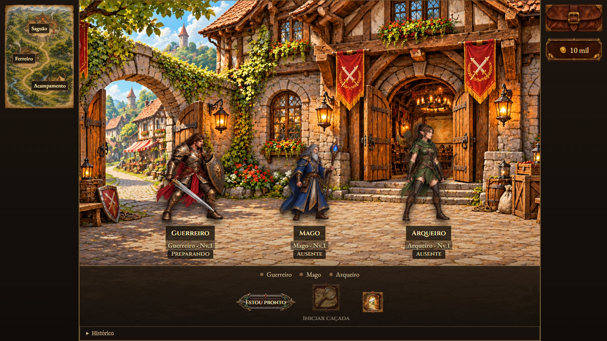
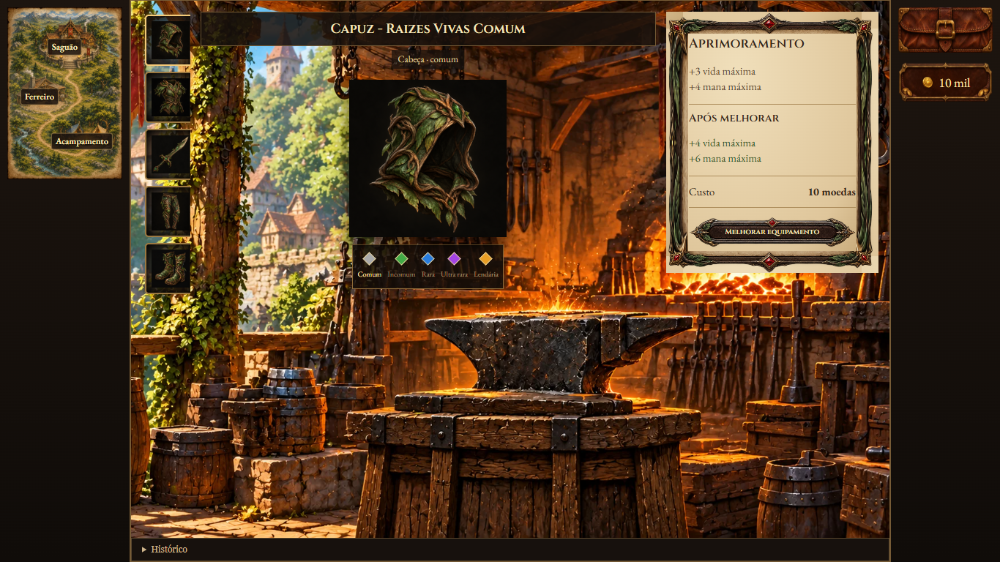
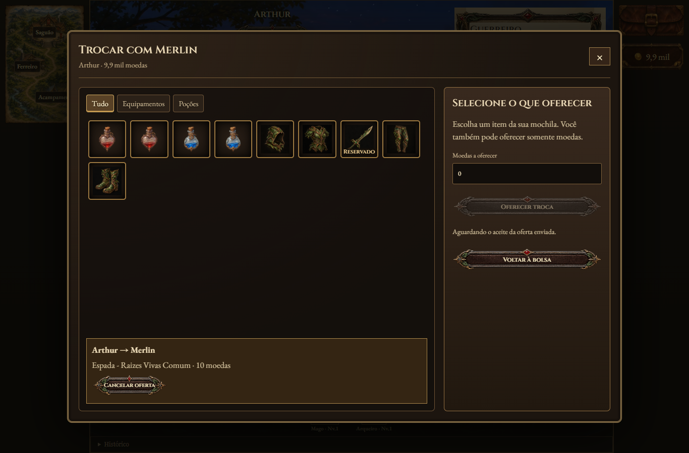

# Base da dungeon — revisão visual

O cabeçalho Dungeon/Campanha/Encerrar e a faixa da jornada foram removidos. O mapa fica à esquerda no desktop; bolsa e moedas ficam à direita. A página cabe na janela sem rolagem externa. Ferreiro e acampamento reutilizam os arquivos de cenário da campanha. Trocas começam pelo personagem presente no acampamento e são oferecidas e aceitas dentro da mochila.

## Prévias

## Artes novas

As duas artes foram geradas pelo recurso integrado `image_gen`, usando imagens da campanha como referências de estilo, e copiadas para o projeto em WebP. Os prompts completos estão nos registros abaixo.

| Arte | Arquivo salvo | Prompt |
|---|---|---|
| Mapa selecionável de três locais | [dungeon-locations-v1.webp](../../assets/visual/maps/dungeon-locations-v1.webp) | [Prompt do mapa](dungeon-locations-v1.json) |
| Pátio do saguão | [dungeon-guildhall-v1.webp](../../assets/visual/backgrounds/scenes/dungeon-guildhall-v1.webp) | [Prompt do saguão](dungeon-guildhall-v1.json) |

## Verificação

25 testes da base e mochila, 25 testes gerais de interface e uma sessão com três navegadores conectados por WebRTC, incluindo oferta e aceite de item e moedas pela interface. Sem erros de página ou arquivos ausentes nos testes registrados. O motor manteve as 1.864 verificações anteriores.

Alterações locais; esta revisão não inclui publicação na main ou no GitHub Pages.

A revisão atual também tem [53 testes de viewport, controles e pós-combate](../qa/ajustes_combate_interface_v5.md), com a porta de saída e as alterações de turnos compartilhadas com a campanha.
