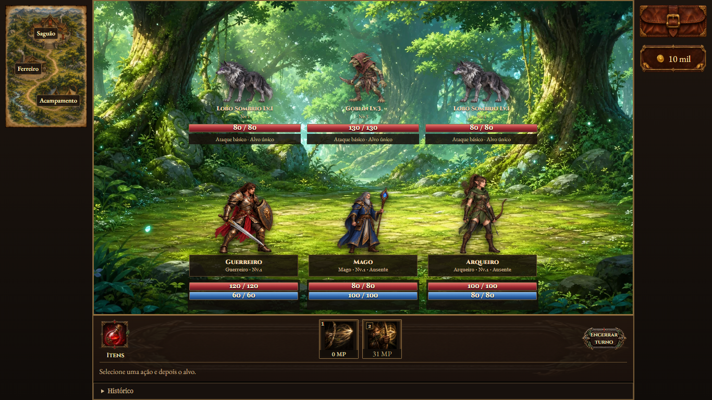
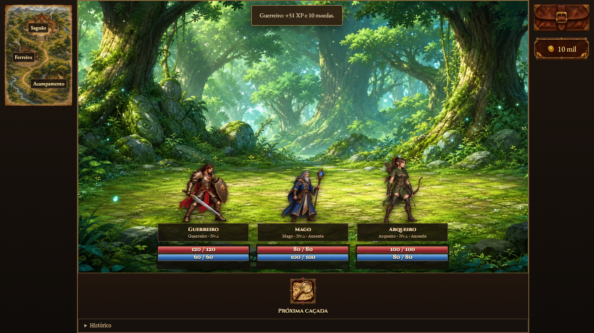
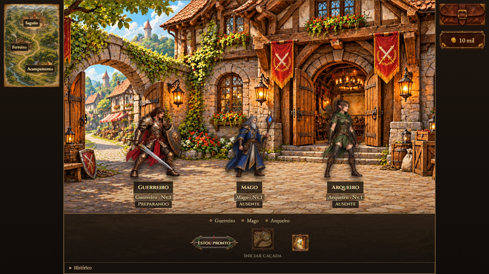

# Ajustes de combate e interface — 06/11/2026

## Dungeon

- A janela usa 100% da largura e altura disponíveis, sem rolagem da página. Listas extensas e detalhes ficam em painéis internos.
- Locais à esquerda; bolsa e moedas à direita. No celular, os controles laterais são compactados acima do cenário.
- Os botões ornamentados têm o fundo externo transparente. Não existe botão extra de abrir bolsa no acampamento nem aba de venda no ferreiro. Vender é uma ação do item selecionado na bolsa, enquanto estiver no ferreiro.
- Itens à esquerda do combate; ataque básico com ícone e atalho 1 junto às habilidades centralizadas; habilidades a partir do atalho 2; encerrar turno à direita.
- Após vencer, o personagem continua no campo de combate, sem inimigos ou habilidades. A faixa de ações oferece a próxima caçada. O mapa permite voltar ao saguão; serviços exigem esse retorno. Se alguém voltar, o grupo precisa se reunir para iniciar novamente.
- A caverna mantém os quatro combates sem serviços entre eles; a pausa também conserva o cenário e o botão do próximo combate.
- A caçada usa a mesma imagem de procurar inimigo da campanha. Uma porta ilustrada no saguão retorna à campanha e conserva a jornada salva.
- Assombrar também é levado ao ataque correspondente da dungeon: a contagem acontece após as ações do afetado. Se a fonte morrer antes, o efeito não força recuo. Se vencer o prazo com a fonte viva, o grupo volta ao saguão, sem recompensa ou avanço desse encontro.

## Regras compartilhadas

- Assombrar, Marca da Morte e efeitos pendentes são resolvidos após a ação do afetado. A vitória por um ataque letal é reconhecida antes desses efeitos.
- Queimadura e outros danos periódicos no inimigo são resolvidos após sua ação, inclusive se ele perder a ação. A queimadura tem atualização da barra e registro próprio no histórico; o último pulso aplica o dano antes de expirar.
- A interface usa o nome da habilidade que concedeu cada efeito. O popup explica os atributos, dano e duração. Fontes de sangramento são preservadas ao salvar e retomar.
- Golpes Velozes do Samurai: dois golpes básicos apresentados em sequência, com dois valores de dano. Cada golpe que causa dano aplica uma pilha de sangramento de `floor(5% × HP máximo do alvo)` por turno, durante três turnos.
- Corte Profundo de Samurai e Ninja: mantém `floor(8% × HP atual do alvo)` na fórmula direta. O sangramento total passa a 30% do dano efetivamente causado, distribuído nos três turnos (`floor(dano × 0,30 / 3)` por turno). As diferenças de coeficientes e penetração entre subclasses são preservadas.

## Evidências

| Verificação | Resultado |
|---|---|
| `test-turn-resolution-v5.cjs` | 21 verificações: ordem de resolução, queimadura, fontes dos efeitos, fórmulas e sequência das animações na campanha. |
| `qa-dungeon-viewport.cjs` | 53 verificações: nove telas em 1920×1080, 1366×768, 1024×600, 390×844 e 320×568; controles, venda na bolsa, impactos em sequência, pós-combate e saída com salvamento. |
| `test-dungeon-journey.cjs` | 1.864 verificações, incluindo 129 usos de habilidades em 28 formas, fonte de Assombrar derrotada, recuo, continuação de caçadas e retorno ao saguão. |
| `test-campaign-enemy-rebalance.cjs` | 151 verificações dos 48 inimigos, efeitos, salvamento e popups. |
| `test-warrior-balance.cjs` | 126 verificações e quatro verificações de interface/salvamento. |
| `test-mage-balance.cjs` | 99 verificações e salvamento/interface. |
| `test-archer-balance.cjs` | 83 verificações de mecânicas, efeitos salvos e interface. |
| `test-dungeon-journey-network.cjs` | Três navegadores via WebRTC, troca pela bolsa, moedas individuais e combate sincronizado. |

Os percursos completos da dungeon registram vitórias para medir a curva de XP, sem afirmar que todas as composições vencem os confrontos. A revisão foi verificada localmente e ainda não foi publicada.

## Prévias

O [ícone da porta](../../assets/visual/hud/icon-exit-adventure.webp) foi gerado pelo recurso integrado `image_gen`; [prompt e referência](../hud/icon-exit-adventure.json).
