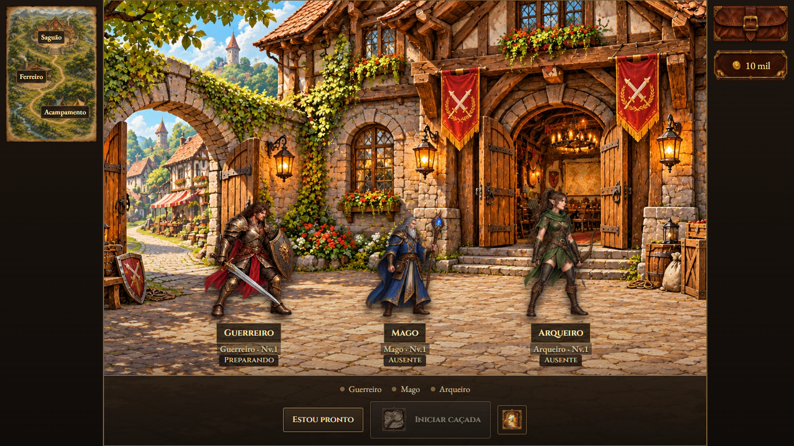
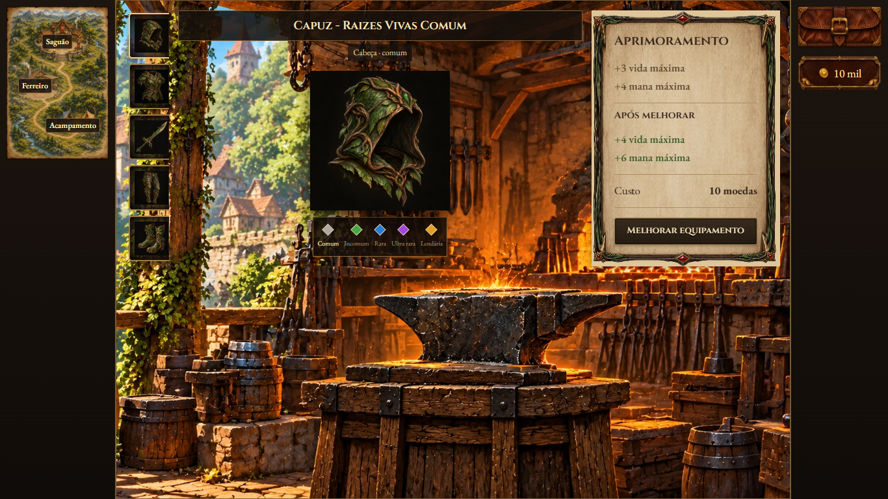
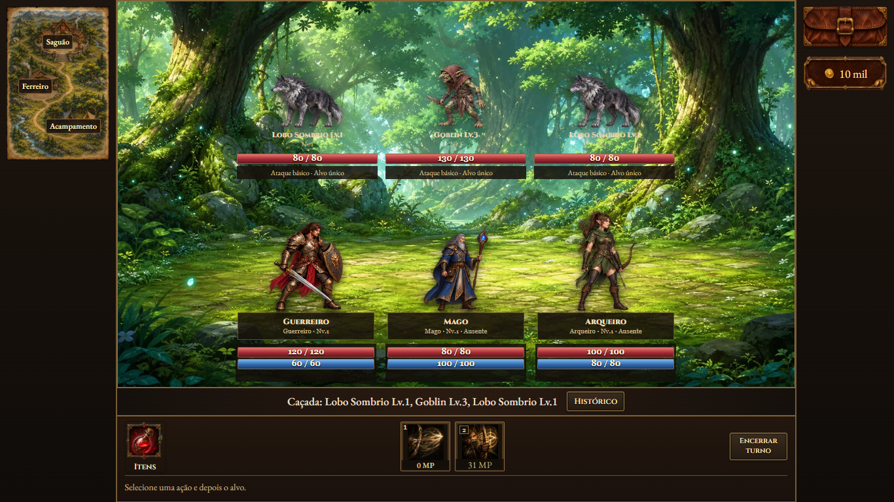
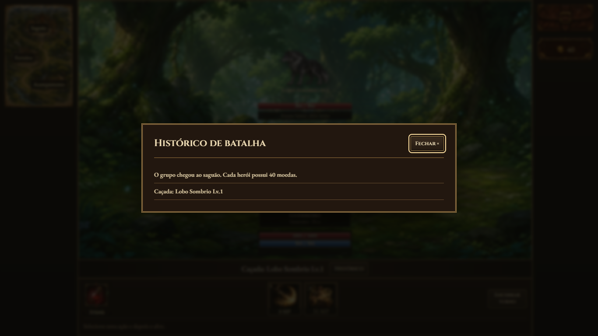

# Apresentação da dungeon — revisão v6

O estado anterior foi publicado na main no commit `c5b731e`. A publicação foi conferida no GitHub Pages por um navegador novo, que criou um herói e iniciou um combate sem erros ou arquivos ausentes; [registro](publication-c5b731e.json).

Esta revisão substitui os botões de ação que usavam molduras de imagem esticadas por controles em CSS, seguindo as cores e bordas dos controles simples da campanha. Ícones de habilidades e a bolsa mantêm suas artes; os controles de ação passam a ter superfícies próprias em CSS. Os painéis de pergaminho agora reservam exatamente a largura de sua borda, como a campanha, evitando sobreposição e deformação das extremidades.

O histórico expansível foi removido. No combate, a mesma faixa `.rpg-chronicle` mostra a última ação e o botão **Histórico**. O botão abre uma janela de **Histórico de batalha**, com registros completos disponíveis e rolagem interna. Fora do combate, a faixa não aparece. A aparência e fonte da faixa foram comparadas com os estilos efetivamente calculados no navegador da campanha.

O arquivo [rpg-interface.css](../../assets/styles/rpg-interface.css) é carregado na campanha e na dungeon para compartilhar a faixa de histórico; também organiza os componentes visuais de ação da dungeon. Regras de combate e progressão permanecem no mesmo motor.

## Validação

- `node scripts/qa-dungeon-presentation.cjs`: sete verificações dos controles, faixa e janela de histórico, comparação real com a campanha e janelas em desktop/celular.
- `node scripts/qa-dungeon-viewport.cjs`: 53 verificações de tamanho, combate, sequência de golpes, mochila e pós-combate.
- `node scripts/qa-dungeon-base-ui.cjs`: 25 verificações de serviços, equipamentos, compras e troca pela bolsa.

